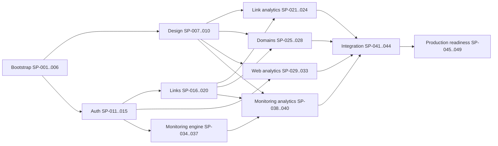

# План разработки в формате GitHub Issues

Приёмка SP-019 включает повторяющиеся query-ключи, fragment и UTM-конфликт. SP-021/032 проверяют смену ключа в полночь UTC и сумму дневных DISTINCT. SP-031 проверяет preflight, точный origin и отсутствие credentials. SP-036/037 проверяют одновременную выдачу двумя экземплярами, истечение аренды и отклонение устаревшего результата.

Каждый пункт ниже — самостоятельный issue размером примерно 0.5–3 дня. `Depends on` задаёт блокирующие связи. Общий Definition of Done: код отформатирован, ошибки не скрыты, новые use cases покрыты уместными unit/integration/component tests, OpenAPI и generated types обновлены вместе с контрактом, документация не утверждает непроверенное.

## Milestone 2 — Project Bootstrap

### SP-001 — Создать skeleton репозитория

**Depends on:** утверждение этапа 1.  
**Scope:** каталоги из `architecture.md`, Go module, Vite React TypeScript без бизнес-функций.  
**Acceptance:** backend/frontend собираются отдельно; нет лишних dependencies; структура описана в README.

### SP-002 — Конфигурация и structured logging backend

**Depends on:** SP-001.  
**Acceptance:** env config валидируется при старте; `.env.example` без secrets; zerolog содержит request ID и не логирует credentials.

### SP-003 — PostgreSQL pool и migration runner

**Depends on:** SP-001, SP-002.  
**Acceptance:** pgxpool с timeouts; golang-migrate CLI/entry documented; приложение не создаёт schema автоматически; rollback smoke-tested.

### SP-004 — Базовый Fiber server и lifecycle

**Depends on:** SP-002, SP-003.  
**Acceptance:** `/healthz` и `/readyz` соответствуют контракту; graceful shutdown проверен тестом; trusted proxy config явный.

### SP-005 — Local Docker Compose

**Depends on:** SP-001–SP-004.  
**Acceptance:** PostgreSQL/backend/frontend запускаются одной командой; migrations применяются явным init step; volumes/ports documented; Caddy только в отдельном profile.

### SP-006 — Базовый CI

**Depends on:** SP-001.  
**Acceptance:** GitHub Actions запускает Go test/vet, frontend lint/typecheck/build и image build; cache не скрывает failures.

## Milestone 3 — UI Design System

### SP-007 — Design tokens, fonts и primitive components

**Depends on:** SP-001.  
**Acceptance:** tokens из `frontend.md`; self-hosted Cyrillic fonts; shadcn/Radix primitives; visible focus и reduced-motion.

### SP-008 — App shell и responsive navigation

**Depends on:** SP-007.  
**Acceptance:** desktop sidebar/topbar и mobile sheet; keyboard accessible; route placeholders без fake metrics.

### SP-009 — Data, chart и feedback component kit

**Depends on:** SP-007.  
**Acceptance:** MetricCard/DataTable/StatusBadge/chart frame/skeleton/error/empty components имеют stories или tests и accessible states.

### SP-010 — Эталонный Overview с demo mode

**Depends on:** SP-008, SP-009.  
**Acceptance:** законченный desktop/mobile экран; demo fixtures изолированы explicit mode; production default показывает empty state; визуальный review перед остальными страницами.

## Milestone 4 — Authentication

### SP-011 — Identity migrations и repositories

**Depends on:** SP-003.  
**Acceptance:** users/sessions constraints и indexes созданы; session token хранится hash; integration tests tenant/session expiry.

### SP-012 — Registration/login/logout services

**Depends on:** SP-011.  
**Acceptance:** Argon2id parameters documented; generic login error; secure cookie flags env-aware; auth rate limit tested.

### SP-013 — CSRF и auth middleware

**Depends on:** SP-012, SP-004.  
**Acceptance:** protected routes reject missing/expired session; unsafe requests reject invalid CSRF/Origin; cookie не уходит на wildcard subdomains.

### SP-014 — Profile/password/session API и OpenAPI auth

**Depends on:** SP-013.  
**Acceptance:** `/me`, password change, list/revoke sessions match `api.md`; password change invalidates other sessions; ownership/error tests.

### SP-015 — Auth/profile frontend

**Depends on:** SP-010, SP-014.  
**Acceptance:** register/login/protected layout/profile/security screens; inline validation and 401 flow; no session secret in browser storage.

## Milestone 5 — Link Shortener

### SP-016 — Domains/links core migrations

**Depends on:** SP-003, SP-011.  
**Acceptance:** domains/links tables, system `go` seed, unique hostname and `(domain,slug)`, FK behavior and rollback tests.

### SP-017 — Link validation and URL composition

**Depends on:** SP-016.  
**Acceptance:** slug/reserved names/http(s)/length/UTM rules unit-tested; incoming query not merged; known internal cycles rejected.

### SP-018 — Link CRUD API

**Depends on:** SP-013, SP-017.  
**Acceptance:** list/search/filter/create/read/update/archive/delete; owner scoped SQL; concurrent slug collision yields 409; OpenAPI/types updated.

### SP-019 — Atomic redirect handler

**Depends on:** SP-017, link_click migration from SP-022 may be introduced minimally here.  
**Acceptance:** Host+slug resolution, 302/no-store, expiry/status/quota, concurrent quota test, original target query preserved, `HEAD` does not count.

### SP-020 — Links frontend

**Depends on:** SP-018, SP-010.  
**Acceptance:** fast create, table/search/filter/copy/edit/archive/delete; responsive and all async states; no demo data.

## Milestone 6 — Link Analytics

### SP-021 — Privacy-safe click enrichment

**Depends on:** SP-019.  
**Acceptance:** device/browser/referrer/UTM/bot and Приблизительные уникальные посетители; raw IP absent from DB/logs; documented method.

### SP-022 — Click schema, retention query and analytics repository

**Depends on:** SP-016.  
**Acceptance:** link_clicks/indexes; range/breakdown/comparison SQL verified against fixtures; empty period and timezone boundaries tested.

### SP-023 — Link analytics and dashboard API

**Depends on:** SP-021, SP-022.  
**Acceptance:** per-link, cross-link and overview contracts; bounded date ranges; no foreign data; p95/percentage semantics documented where relevant.

### SP-024 — Link analytics frontend

**Depends on:** SP-023, SP-009.  
**Acceptance:** date range, comparison, series/breakdowns/table/recent events; approximate label; accessible chart fallback; empty state.

## Milestone 7 — Domain Management

### SP-025 — Personal subdomain lifecycle

**Depends on:** SP-016, SP-013.  
**Acceptance:** validation/reserved list/one-per-user limit; concurrency uniqueness; active subdomain works through Host integration tests without per-user DNS.

### SP-026 — Custom domain verification

**Depends on:** SP-025.  
**Acceptance:** pending challenge/rotation/expiry, TXT ownership lookup, CNAME shown but not accepted as ownership; state transitions and DNS errors tested with fake resolver.

### SP-027 — Domain frontend

**Depends on:** SP-026, SP-010.  
**Acceptance:** subdomain/custom flows, lifecycle stepper, exact copyable DNS instructions, local-mode disclaimer and errors.

### SP-028 — Caddy routing design implementation (non-production)

**Depends on:** SP-026, SP-005.  
**Acceptance:** local/test Caddy profile routes apex/go/test subdomains; internal allow endpoint denies non-active domains; no real certificate/DNS operation; production steps remain documentation only.

## Milestone 8 — Web Analytics

### SP-029 — Sites/origins/events schema and CRUD

**Depends on:** SP-013.  
**Acceptance:** migrations and owner-scoped CRUD; canonical explicit origins; public ID non-secret semantics documented.

### SP-030 — Lightweight tracker

**Depends on:** SP-029.  
**Acceptance:** small dependency-free bundle; initial/SPA pageviews, custom events, UTM/referrer, beacon/fetch; sensitive query stripped; no cookies/form/page capture; browser tests.

### SP-031 — Hardened collector endpoint

**Depends on:** SP-029.  
**Acceptance:** origin/schema/size/batch/time-window/rate limits; idempotent event ID; malicious nested/oversized payload tests; uniform unknown-site response.

### SP-032 — Web analytics queries/API

**Depends on:** SP-031.  
**Acceptance:** Приблизительные уникальные посетители/pages/referrers/devices/events/UTM/time series; timezone/range tests; tenant isolation.

### SP-033 — Websites frontend and integration demo

**Depends on:** SP-030, SP-032.  
**Acceptance:** site CRUD/snippet/origins/analytics; separate demo site sends real events in demo environment; production has no fake events.

## Milestone 9 — Monitoring Engine

### SP-034 — Monitor schema and CRUD API

**Depends on:** SP-013.  
**Acceptance:** constraints from database design; GET/HEAD only, interval/timeout/status range; owner isolation; pause/resume transitions.

### SP-035 — Safe HTTP client / SSRF guard

**Depends on:** SP-034.  
**Acceptance:** all cases in `routing-monitoring.md` security test matrix pass; pinned resolved IP; proxy disabled; redirects blocked; body/time/header limits.

### SP-036 — PostgreSQL scheduler leases and worker pool

**Depends on:** SP-034, SP-035.  
**Acceptance:** `SKIP LOCKED` leasing, bounded concurrency/jitter, expired lease recovery, no network call inside transaction, graceful shutdown/race tests.

### SP-037 — Check result persistence and state machine

**Depends on:** SP-036.  
**Acceptance:** DNS/TCP/TLS/timeout/status errors categorized; first failure degraded, second down, success operational; atomic next run; response body absent.

## Milestone 10 — Monitoring Analytics

### SP-038 — Incidents and monitor aggregates

**Depends on:** SP-037.  
**Acceptance:** one open incident per monitor; recovery closes it; uptime/sample count/average/p95 verified with fixtures; retention query.

### SP-039 — Link-target monitoring integration

**Depends on:** SP-018, SP-038.  
**Acceptance:** link toggle atomically creates/removes one monitor owned by same user; target update syncs URL; direct API cannot forge link association.

### SP-040 — Monitoring frontend

**Depends on:** SP-038, SP-009.  
**Acceptance:** list/detail, status, uptime strip, latency, checks, sanitized errors, incidents; discrete-estimate copy; responsive/accessibility states.

## Milestone 11 — Integration and hardening

### SP-041 — End-to-end contract/type reconciliation

**Depends on:** SP-015, SP-020, SP-024, SP-027, SP-033, SP-040.  
**Acceptance:** OpenAPI matches handlers; TS types regenerated; no production stubs; error/loading/empty paths audited.

### SP-042 — Retention maintenance loop

**Depends on:** SP-022, SP-029, SP-038.  
**Acceptance:** configurable batched purge for clicks/events/checks; indexed plans reviewed; cancellation and dry fixture tests; retention visible in docs.

### SP-043 — Cross-module Playwright suite

**Depends on:** SP-041.  
**Acceptance:** registration→link→redirect→analytics, domain local flow, tracker event, monitor flow on desktop/mobile; deterministic test services, no public DNS dependency.

### SP-044 — Demo seed and full quality pass

**Depends on:** SP-043.  
**Acceptance:** explicit demo seed only; Go race/vet/tests and frontend lint/typecheck/build/component/E2E actually run and results recorded; fake production data absent.

## Milestone 12 — Production Readiness (без автоматического deployment)

### SP-045 — Production Caddy/Docker configuration

**Depends on:** SP-028, SP-044.  
**Acceptance:** apex/go/wildcard/custom host routing, trusted proxies and Caddy ask protection documented/testable locally; configs contain no credentials; no DNS change performed.

### SP-046 — Security and privacy review

**Depends on:** SP-044, SP-045.  
**Acceptance:** session/CSRF/ownership/rate-limit/SSRF/log redaction/headers/dependency review; findings tracked; critical/high resolved.

### SP-047 — Backup, restore and operations guide

**Depends on:** SP-045.  
**Acceptance:** PostgreSQL backup and tested restore procedure, health/log/retention/rollback/runbook; RPO/RTO assumptions stated.

### SP-048 — VPS/DNS/TLS deployment guide

**Depends on:** SP-045–SP-047.  
**Acceptance:** explicit prerequisites for `saturnita.ru`, wildcard DNS, DNS-01 credential scope, custom-domain TLS and verification checklist; all commands are documentation and require user confirmation before real execution.

### SP-049 — Release readiness review

**Depends on:** SP-046–SP-048.  
**Acceptance:** SPEC criteria traced to evidence; README/ERD/C4/OpenAPI current; known limitations listed; actual production deployment remains a separately authorized action.

## Dependency overview

