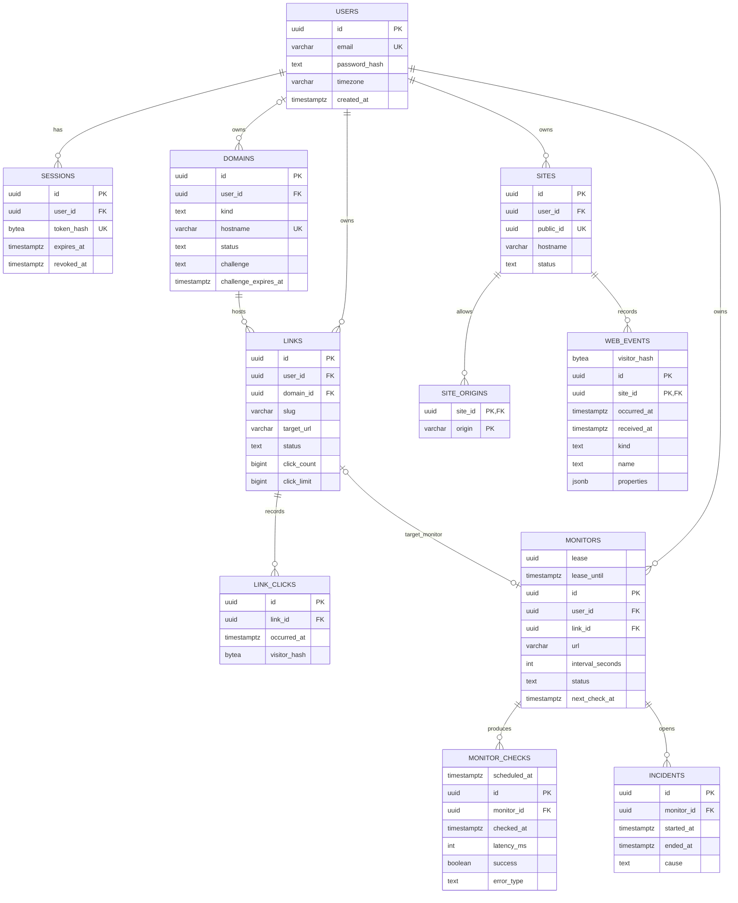
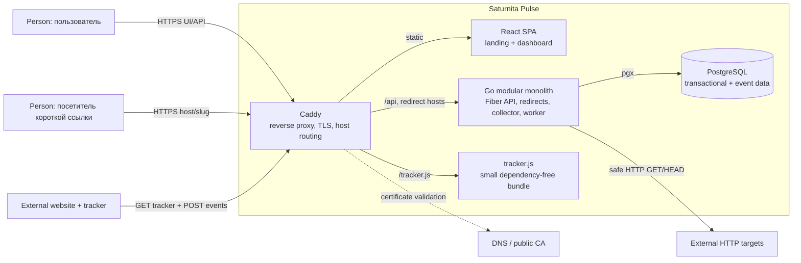
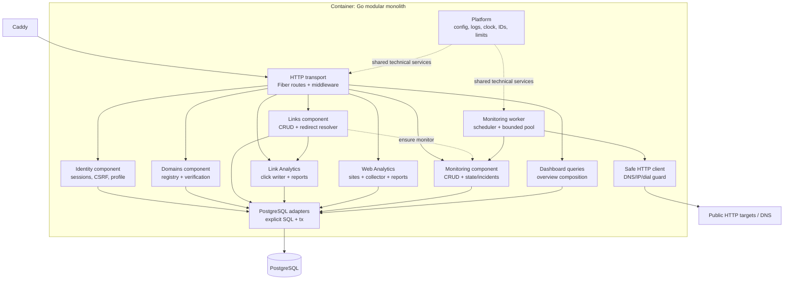

# Диаграммы

Для обоих потоков событий visitor_hash хранит дневной псевдоним. Статистика принадлежит ссылке или сайту, результаты проверок — монитору. Сессии SESSIONS используются для входа в кабинет.

Диаграммы используют Mermaid и должны рендериться в GitHub. C4 показан обычными flowchart-блоками для совместимости с GitHub Mermaid.

## ERD

`slug` уникален не глобально, а составным ключом `(domain_id, slug)`. На диаграмме это сокращено из-за ограничений нотации.

## C4 Container

## C4 Component — Go backend

