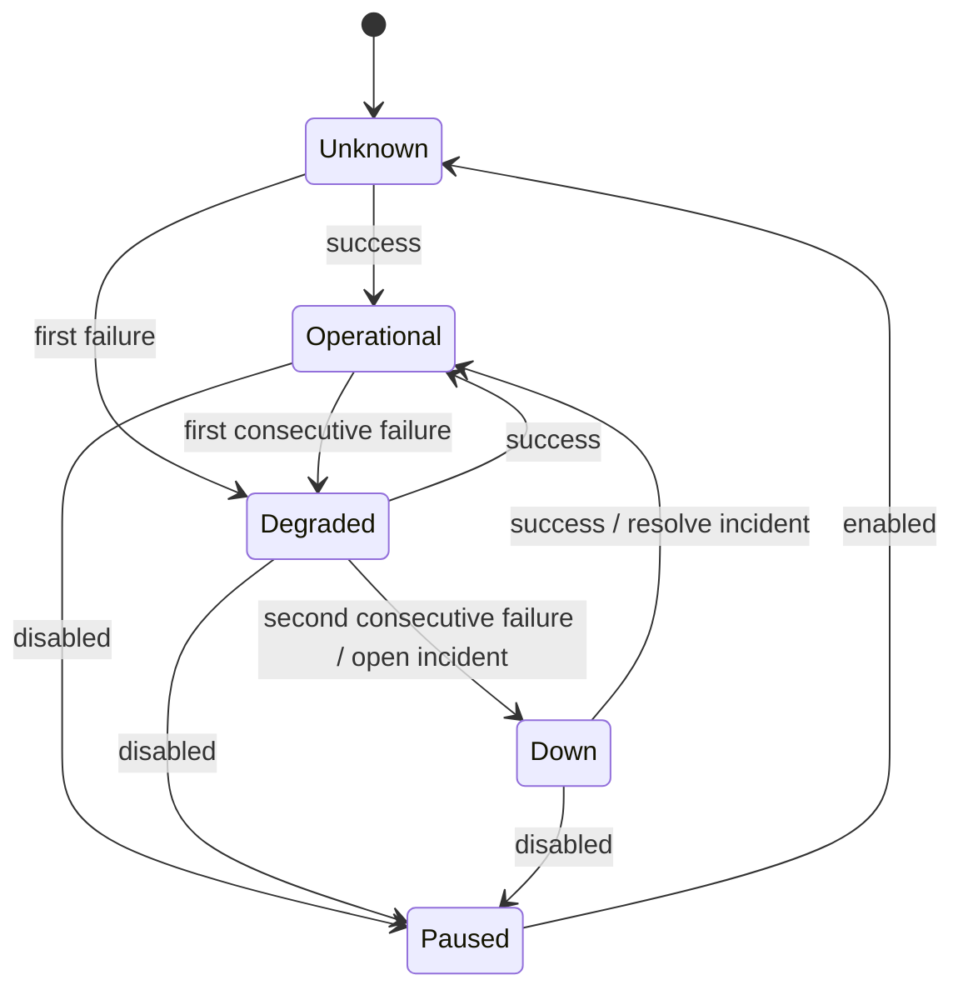

# Маршрутизация, redirect и monitoring worker

При простое пропускаются устаревшие интервалы. Выдача, фиксация и отбрасывание просроченного результата описаны в database.md. Архивирование отключает redirect и ставит привязанный монитор на паузу, сохраняя историю. Удаление каскадно очищает только связанные записи. При сборке Location сохраняем raw query и fragment цели, заменяем только пары явно заданных UTM по декодированному имени, кодируем новое значение ровно один раз. Дубликаты остальных ключей, порядок и исходное экранирование сохраняются.

## 1. Матрица host/path

| Host | Path | Обработчик |
|---|---|---|
| `saturnita.ru`, `www.saturnita.ru` | `/api/v1/*`, `/healthz`, `/readyz` | Go backend (`www` можно 308 на apex, кроме системных путей) |
| `saturnita.ru` | `/tracker.js` | versioned/static tracker asset |
| `saturnita.ru` | остальные пути | React SPA с history fallback |
| `go.saturnita.ru` | `/{slug}` | Go redirect handler |
| `{active-user}.saturnita.ru` | `/{slug}` | Go redirect handler |
| active custom domain | `/{slug}` | Go redirect handler |
| reserved/unknown subdomain | любой | `404`, без SPA/redirect lookup |

`api`, `www`, `go`, `admin`, `mail`, `health` и прочие системные labels находятся в versioned deny-list. Apex никогда не интерпретирует произвольный первый path segment как slug, поэтому `/login` и SPA routes не конфликтуют с ссылками. На redirect host допустим ровно один percent-decoded path segment; `/`, вложенные пути и служебные paths дают branded 404.

Для local development используются явные hosts (`app.localhost`, `go.localhost`, `alex.localhost`) либо заголовок Host в integration tests. Wildcard DNS/TLS не симулируется как «уже настроенный».

## 2. Caddy и доверенная граница

Caddy завершает TLS, нормализует/проверяет Host и проксирует backend. Backend принимает forwarded headers только от настроенных trusted proxy CIDR; иначе использует socket peer/Request Host. Host:

- переводится в lowercase, trailing dot удаляется;
- IDN переводится в ASCII при регистрации (не в hot path); mixed/confusable labels отклоняются консервативно;
- port удаляется только корректным parser;
- IP literals и malformed host запрещены для domain routing.

Wildcard `*.saturnita.ru` должен указывать на VPS, wildcard certificate — выдаваться DNS-01. Это будущая production операция, не часть текущего этапа.

Для custom domains предлагается Caddy On-Demand TLS. Обязательная защита: `ask` endpoint backend разрешает issuance только для `domains.status='active'`; endpoint доступен лишь во внутренней Docker network и дополнительно защищён shared token/mTLS. Добавляются Caddy issuance rate limits. Pending/verified, но не active домен сертификат не получает.

## 3. Redirect flow

1. Из trusted request получить canonical host и один canonical slug.
2. Найти `domain(active) + link` индексом `(hostname)` и `(domain_id, slug)`.
3. В одной короткой DB-транзакции проверить status/expiry/quota, атомарно увеличить counter и записать privacy-safe click.
4. Собрать target: parse сохранённого URL, применить только настроенные UTM; входящий query не переносить.
5. Проверить loop rule: target host/path не должен разрешаться в эту же link или образовывать известный внутренний цикл. При create/update выполняется bounded graph walk по Saturnita links; в redirect остаётся fail-safe hop marker/maximum internal resolution.
6. Commit и ответить `302 Found`, `Location`, `Cache-Control: no-store`, `Referrer-Policy: no-referrer-when-downgrade`.

Redirect handler сам не загружает target URL. SSRF здесь отсутствует; URL validation всё равно разрешает только `http/https`. Ошибка записи клика в выбранной строгой модели означает отсутствие redirect (`503`), иначе quota и аналитика могут расходиться. Позднее это можно пересмотреть при доказанных latency/SLA требованиях.

## 4. Monitoring scheduler

Worker запускается после readiness DB и останавливается через общий context. Состав:

- scheduler tick (например, каждую секунду) получает до `workers * 2` due jobs;
- PostgreSQL lease с `FOR UPDATE SKIP LOCKED` предотвращает одновременную выдачу;
- bounded channel и фиксированный pool (начально 10 workers, config with safe max);
- каждый job получает context deadline не длиннее monitor timeout и глобального max;
- completion transaction записывает check, status, next run и incident transition;
- scheduling использует `next_check_at = max(now, previous_next + interval)` с небольшим deterministic jitter, чтобы избежать burst;
- graceful shutdown прекращает leasing, ждёт активные checks до общего deadline, leases затем истекают.

Ретраи внутри одной проверки не выполняются: они искажают sample cadence и усиливают нагрузку. Следующая периодическая проверка служит повтором. Ручной `/check` лишь ставит `next_check_at <= now` с per-user rate limit.

Status machine:

Uptime = successful checks / all checks in range. p95 вычисляется PostgreSQL `percentile_cont(0.95)`. UI всегда показывает sample count и поясняет дискретную оценку.

## 5. SSRF threat model и защита

Атакующий контролирует URL, DNS records и HTTP redirect response и пытается достичь loopback, private services, cloud metadata или исчерпать ресурсы.

### Validation before scheduling

- parse через `net/url`; только `http`/`https`;
- userinfo запрещён; fragment удаляется; hostname обязателен;
- ports: только 80/443 в MVP (расширение — явная allow-list), IP literals проходят те же range checks;
- URL length <= 2048; Unicode hostname canonicalized;
- metadata hostnames и well-known endpoints deny-listed, но deny-list не заменяет IP checks.

### DNS and connection binding

1. На каждый request выполнить resolver lookup с deadline.
2. Отклонить весь hostname, если **хотя бы один** A/AAAA адрес непубличный/запрещённый; это консервативно закрывает mixed answers.
3. Запрещённые сети включают unspecified, loopback, private, link-local unicast/multicast, CGNAT, documentation, benchmarking, multicast, IPv4 broadcast/reserved, IPv6 ULA/site-local/documentation, IPv4-mapped эквиваленты и cloud metadata (`169.254.169.254`, IPv6 аналоги). Используется `net/netip`, тестовая таблица ranges.
4. Custom `http.Transport.DialContext` соединяется **только** с одним из уже проверенных IP, сохраняя original hostname для TLS SNI и Host header. Нельзя позволять default transport повторно резолвить hostname.
5. После connect фактический remote address повторно проверяется. DNS cache между jobs не используется дольше TTL/одной попытки.

### Redirects and resource limits

- `CheckRedirect` возвращает `http.ErrUseLastResponse`: redirects не следуются в MVP; 3xx оценивается только если входит в expected status range.
- Timeout охватывает DNS, connect, TLS, headers и чтение.
- Response body для GET читается максимум 64 KiB и отбрасывается; для HEAD body не читается. Compression отключена либо считается после decompression с лимитом.
- Ограничены response headers, idle connections, per-host connections и общий parallelism; transport не использует environment proxy (`Proxy: nil`).
- Никаких custom headers, credentials, cookies, POST bodies, Unix sockets или нестандартных protocols.
- Sanitized error не содержит response body/секретный query. Query можно показывать владельцу monitor, но не писать целиком в operational logs.

### Defense in depth

На production желателен egress firewall/container policy, запрещающий backend доступ к RFC1918/link-local/metadata, кроме PostgreSQL по отдельному network path. Поскольку backend одновременно должен ходить в PostgreSQL, сетевое разделение удобнее после вынесения worker; для MVP основная гарантия находится в safe dialer и обязательных bypass tests.

## 6. Обязательные security tests

- IPv4/IPv6 loopback, private, link-local, CGNAT, metadata, encoded/mapped IP;
- hostname с mixed public/private DNS answers;
- DNS rebinding между validation и dial (dial использует pinned IP);
- redirect public → private (redirect не выполняется);
- URL userinfo, malformed port, non-HTTP scheme, oversized URL;
- timeout на DNS/connect/TLS/body, oversized/chunked/compressed body;
- proxy environment ignored;
- worker lease expiry, duplicate schedulers и graceful cancellation.

